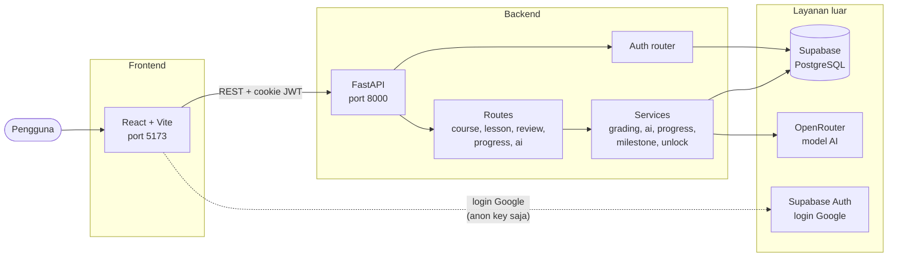
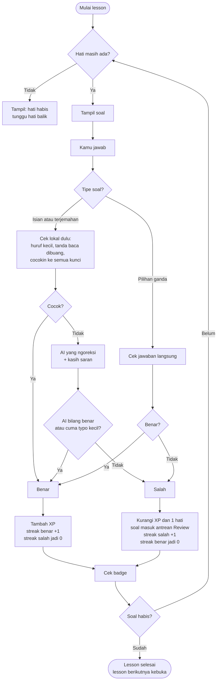
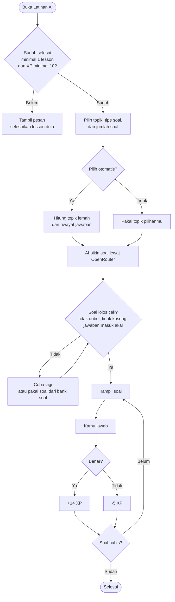
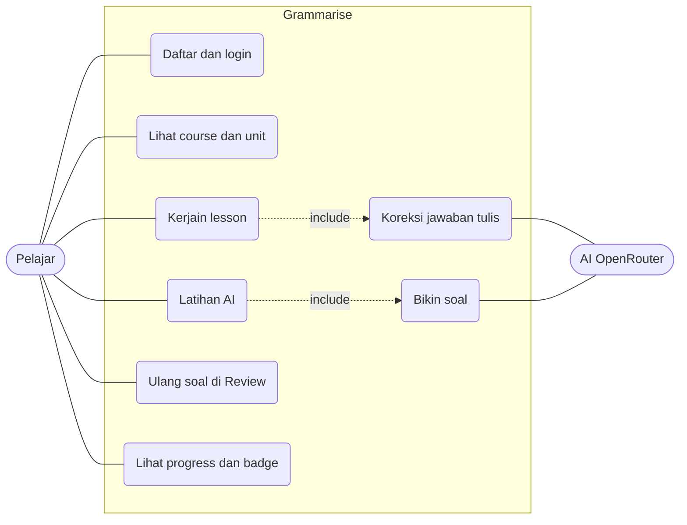
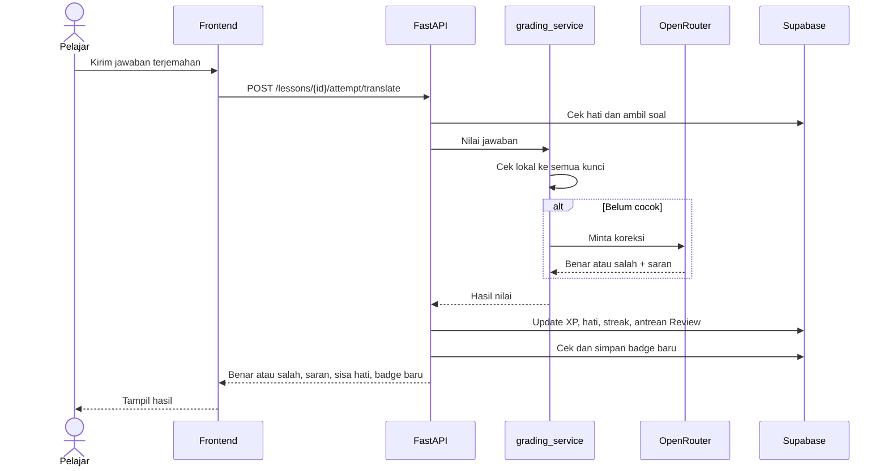
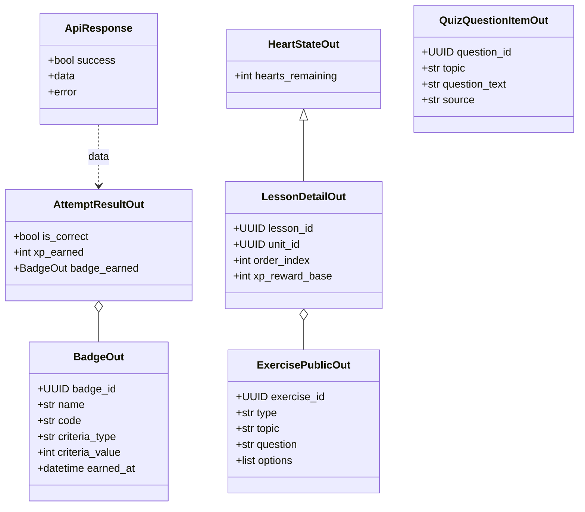
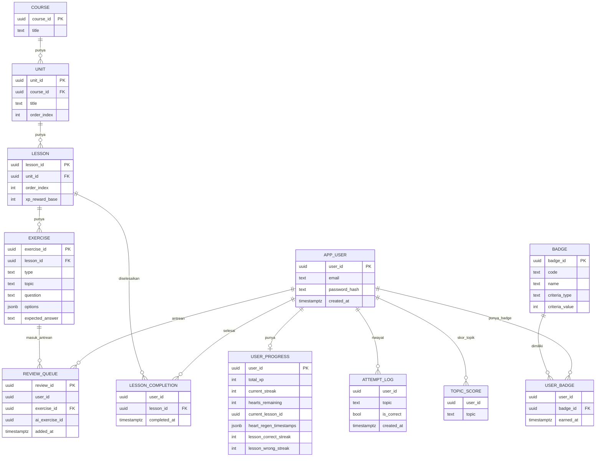

# Grammarise

Belajar English tanpa bikin kepala pusing. Dibuat buat **LOGICODIX 2026**.

Grammarise itu web belajar English buat kamu yang males baca English. Soalnya pendek, ada hati dan XP, ada badge juga. Rasanya kayak main game, bukan kayak belajar.

---

## Daftar isi

1. [Masalahnya apa](#masalahnya-apa)
2. [Solusi kita](#solusi-kita)
3. [Buat siapa](#buat-siapa)
4. [Fitur](#fitur)
5. [Teknologi](#teknologi)
6. [Arsitektur](#arsitektur)
7. [Flowchart](#flowchart)
8. [UML](#uml)
9. [ERD](#erd)
10. [Cara install](#cara-install)
11. [Kontributor](#kontributor)

---

## Masalahnya apa

Banyak anak muda pengen jago English, tapi males baca teks panjang. Belajar jadi berat, terus berhenti di tengah jalan.

Duolingo sudah terbukti bikin orang betah belajar. Jadi kita **gak buang waktu bikin ulang hal yang sudah jalan**. Kita ambil pola yang sudah terbukti, terus kita isi 2 celah yang Duolingo kunci di balik tembok bayar.

## Solusi kita

**Celah pertama: soal latihan AI yang jelas asalnya.**
Soal latihan AI kita dipilih dari topik yang paling sering kamu salah. Jadi kamu tahu soal itu muncul bukan asal-asalan. Misalnya kamu sering salah di Past Tense, maka soal Past Tense yang lebih sering muncul. Setiap soal juga nunjukin topiknya dan asalnya, dari AI atau dari bank soal.

**Celah kedua: AI yang ngoreksi jawaban tulis dan terjemahan, gratis.**
Di Duolingo, fitur ini ada di paket berbayar (Duolingo Max). Di Grammarise, fitur ini ada di versi gratis dari awal.

Jadi bukan bikin ulang Duolingo. Kita ambil pola yang sudah terbukti, terus kita isi 2 celah yang sengaja mereka kunci.

## Buat siapa

Buat Gen Z yang males baca English.

---

## Fitur

| Fitur | Penjelasan singkat |
|---|---|
| Login | Bisa pakai email dan password, bisa juga pakai Google |
| Course, unit, lesson | Materi dibagi per unit, tiap unit isinya beberapa lesson pendek |
| Soal lesson | Pilihan ganda, isian, dan terjemahan |
| Koreksi AI | Jawaban isian dan terjemahan dikoreksi AI, gratis |
| Latihan AI | Soal dibuat AI dari topik yang sering kamu salah. Butuh minimal 10 XP buat buka |
| Review | Soal yang pernah salah masuk antrean buat diulang. Benar dapat +5 XP |
| Hati | Maksimal 5. Salah di lesson kehilangan 1 hati. Hati balik pelan-pelan |
| XP | Benar nambah XP, salah di lesson ngurangin XP |
| Streak | Hitung hari belajar berturut-turut |
| Badge | Ada 4 badge, lihat tabel di bawah |

### Badge

| Badge | Cara dapat |
|---|---|
| Miss Mulu | Salah 6 kali berturut-turut di lesson (lebih dari 5 kali) |
| Mulai Serius Nih | Benar 4 kali berturut-turut di lesson |
| Calon Juara | Total XP sampai 450 |
| Sang Juara | Total XP sampai 1800. Harus sudah punya Calon Juara dulu |

Badge yang sudah didapat gak pernah dicabut, walau XP turun.

---

## Teknologi

| Bagian | Pakai apa |
|---|---|
| Frontend | React 19, TypeScript, Vite, Tailwind CSS v4, React Router, Motion, Lenis, lucide-react |
| Backend | Python, FastAPI, Pydantic |
| Database | Supabase (PostgreSQL) |
| Login | Email dan password (JWT di cookie), Google lewat Supabase Auth |
| AI | OpenRouter |
| Penilaian lokal | RapidFuzz |
| Cache | cachetools |

---

## Arsitektur

Frontend ngobrol ke backend lewat REST API. Cuma backend yang boleh ngobrol ke database pakai kunci rahasia, dan cuma backend yang boleh manggil AI.



---

## Flowchart

### Alur jawab soal di lesson



### Alur Latihan AI



---

## UML

### Use case



### Sequence: jawab soal terjemahan



### Class diagram



---

## ERD

Ini tabel-tabel utama di database. Ada dua tempat nyimpen akun: `app_user` buat email dan password, `auth.users` buat Google. Karena itu tabel progres gak dikunci foreign key ke satu tabel user saja, jadi dua jenis akun sama-sama bisa dipakai.



Catatan: kolom `user_id` di tabel progres bisa nunjuk ke `app_user` atau ke `auth.users` (akun Google). Di diagram, semuanya digambar ke `APP_USER` biar mudah dibaca.

---

## Cara install

### Yang harus ada dulu

- Git
- Python 3.11 atau lebih baru
- Node.js 20 atau lebih baru
- Akun [Supabase](https://supabase.com)
- Akun [OpenRouter](https://openrouter.ai) buat API key

### 1. Clone repo

```bash
git clone https://github.com/jojohyperbackend-hub/ENduckLearning.git
cd ENduckLearning
```

### 2. Jalanin backend

```bash
cd backend
python -m venv .venv
```

Aktifin venv:

```bash
# Mac atau Linux
source .venv/bin/activate

# Windows
.venv\Scripts\activate
```

Install paket dan jalanin:

```bash
pip install -r requirements.txt
```

Bikin file `backend/.env.local`, isinya:

```env
SUPABASE_URL=isi_url_supabase_kamu
SUPABASE_ANON_KEY=isi_anon_key
SUPABASE_SERVICE_ROLE_KEY=isi_service_role_key
OPENROUTER_API_KEY=isi_api_key_openrouter
JWT_SECRET=isi_teks_acak_yang_panjang
ENVIRONMENT=development
```

Nyalain servernya:

```bash
uvicorn app.main:app --reload --port 8000
```

Buka `http://localhost:8000`. Kalau muncul `backend berjalan`, berarti aman.

### 3. Jalanin frontend

Buka terminal baru:

```bash
cd frontend
npm install
```

Bikin file `frontend/.env.local`, isinya:

```env
VITE_API_BASE_URL=http://localhost:8000
VITE_SUPABASE_URL=isi_url_supabase_kamu
VITE_SUPABASE_ANON_KEY=isi_anon_key
```

Jalanin:

```bash
npm run dev
```

Buka `http://localhost:5173`.

---

## Kontributor

| Nama | Role |
|---|---|
| Ata Jauza | Full stack dan leader |
| Anas Faiq | Front end |
| Khidir Ali | Backend |
| Gabe | UI UX |
